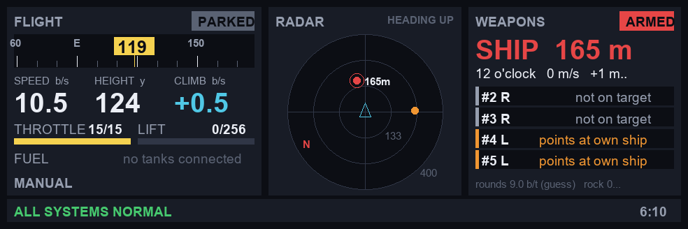

# CC Warship

[Ship Pilot](https://github.com/levisnakes/cc-ship-pilot) and [Fire Control](https://github.com/levisnakes/cc-fire-control) on **one** computer and **one** screen on a Sable ship. You fly from the Linked Typewriter while the radar-aimed cannons fire by themselves.

## Install

```
rm startup.lua
wget https://raw.githubusercontent.com/levisnakes/cc-warship/main/warship.lua startup.lua
reboot
```

On boot it downloads the newest `ship.lua` and `fire_control.lua`. If you already have `ship.lua`, `ship.cfg` or `fire_control.lua`, it keeps and uses them.

## How it looks

It's the normal Ship Pilot, titled **Warship**. The menu's **A** tile is **Auto cannons** instead of Go to:

| Key | Auto cannons screen |
|---|---|
| A | arm / safe |
| F | fire every cannon that's clear of your own ship, right now |
| X | ignore the nearest target for good (for parts of your own ship) |
| U | un-ignore everything |
| Q | back to the menu |

The screen also shows the radar, round speed, ship speed and rock, the nearest targets, and what every cannon is doing (L/R side, ON TARGET, FIRING, own ship in line, and how far it would miss).

- Fire Control runs in the background the whole time, so the cannons work while you're flying.
- **F on the typewriter arms/safes the cannons from any screen**, including while flying. A speaker (if connected) beeps high for armed and low for safe. Change the key in Keybinds (K), under "Arm/safe guns". Like every typewriter key besides movement, it has to be bound to a Redstone Link frequency on the typewriter (sneak + right-click it).
- A red **ARMED** badge sits in the title bar on every screen while they're armed, and the Fly screen has a guns line.
- Only the computer's own keys (and screen/monitor taps) work on the Auto cannons screen. Typewriter keys fly the ship, so turning left with A can't arm the cannons.
- If Fire Control crashes, the pilot keeps flying. The Auto cannons screen shows the error, and **R** restarts it.
- Ctrl+T stops both: thrusters off, lift held, triggers released.

## Captain's display

Put a wide Advanced Monitor (3x1 works well) and a **DirectGPU** on the ship's wired network. Warship finds the widest monitor by itself, or you can set `CAPTAIN_MONITOR` at the top of `startup.lua`.



- **Flight:** what the ship is doing (HOVER/CLIMB/PARKED...), a compass heading tape, speed, height, climb rate, throttle, lift, fuel with time left, and who's flying (manual, smart heading hold, autopilot).
- **Radar:** heading-up (the nose points up), range rings, every target, and the nearest one ringed with its distance.
- **Weapons:** ARMED/SAFE, the nearest target (distance, clock bearing like "2 o'clock", speed), and every cannon's state (FIRING, ON TARGET, aiming, own ship in line...).
- **Warning strip:** low fuel, fuel alarm, guns stopped, no radar, Fire Controller on the network, overstressed machines, relay errors, missing typewriter, holding fire while rocking. Red warnings blink. If nothing's wrong it says ALL SYSTEMS NORMAL. The in-game time is on the right.

## Hardware

Everything both programs need, on the same wired modem network as the computer: Linked Typewriter, thrusters, relay/transmission (pilot), Cannon Mounts and a radar (guns). See each program's README.

## Settings

| Program | Where |
|---|---|
| Pilot | its menus (saved in `ship.cfg`) or `ship_settings.lua` |
| Guns | the UPPERCASE lines at the top of `fire_control.lua` (`SIDES`, `AUTOCANNON`, ...), or `/config.lua` |

## Updates

- Warship and Ship Pilot update at boot, so a restart is an update.
- Fire Control's own 15-minute updater keeps working. When it updates, it restarts **only the guns**, never the whole computer, so the ship keeps flying.
